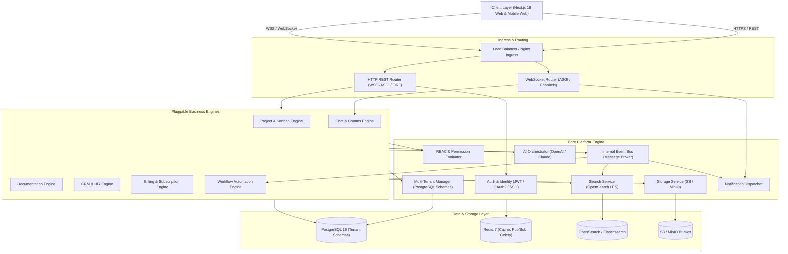
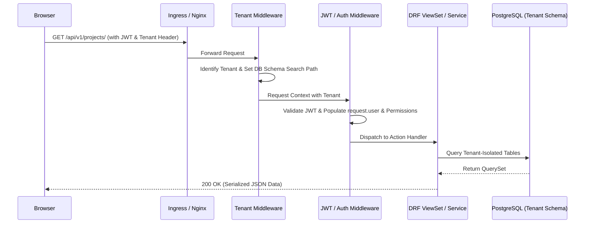
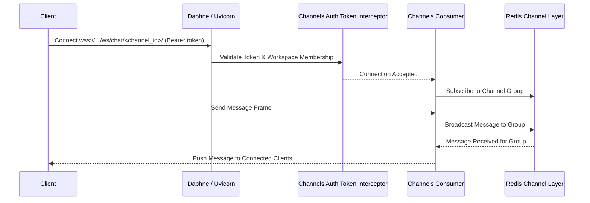
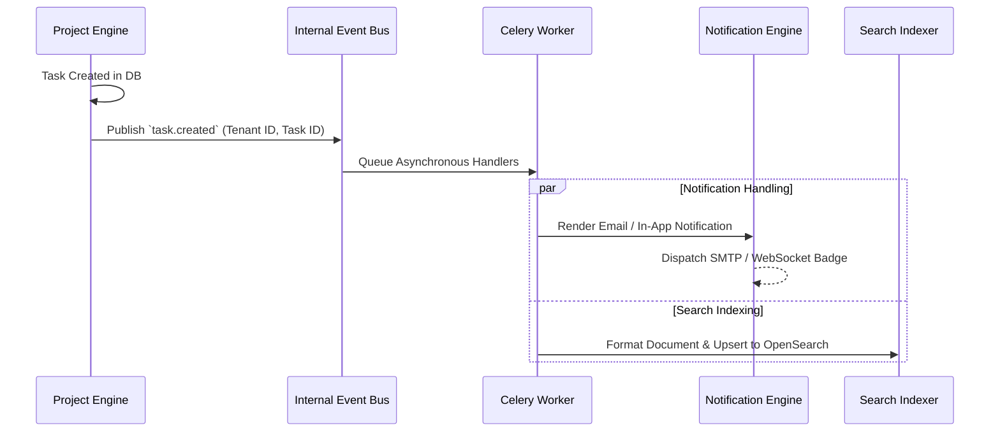

# Architecture: amops DevOS

## Technology Stack

The stack represents the architectural target established in the project specifications. Since the repository is currently in the pre-implementation phase, all components are marked with their planned implementation status.

| Layer | Technology | Version / Specification | Status | Rationale |
| :--- | :--- | :--- | :--- | :--- |
| **Backend Framework** | Python / Django | Python 3.12+, Django 5.2 LTS | Planned | High security defaults, mature ORM, built-in admin, robust ecosystem for enterprise SaaS |
| **API Framework** | Django REST Framework | DRF 3.16+ | Planned | Standardized serializers, viewsets, pagination, filtering, and OpenAPI compatibility |
| **Async & WebSockets** | Django Channels | Channels 4.x (ASGI) + Daphne/Uvicorn | Planned | Native WebSocket handling for chat, live Kanban sync, and presence |
| **Task Queue** | Celery | Celery 5.x + Redis broker | Planned | Reliable asynchronous execution for emails, indexing, reports, and AI jobs |
| **Primary Database** | PostgreSQL | PostgreSQL 16 | Planned | Schema-based multi-tenancy (`django-tenants`), JSONB support, relational integrity |
| **In-Memory Cache & Broker** | Redis | Redis 7.x (or ElastiCache / Upstash) | Planned | Fast key-value cache, session store, Channels pub/sub layer, Celery broker |
| **Full-Text Search** | OpenSearch / Elasticsearch | OpenSearch 2.x / Elasticsearch 8.x | Planned | High-performance search, fuzzy matching, and faceting across tasks and docs |
| **Object Storage** | MinIO / AWS S3 | S3-Compatible API | Planned | Scalable attachment and asset storage with presigned upload/download URLs |
| **Event Bus** | RabbitMQ / Kafka / Redis | Domain Message Broker | Planned | Decoupled cross-engine event dispatching for side effects |
| **Frontend Framework** | Next.js | Next.js 16.x (React 19+, TypeScript) | Planned | Full-stack React with App Router, SSR, SSG, route handlers, and optimization |
| **UI Styling & Components** | Tailwind CSS + shadcn/ui + Lucide | Radix UI Primitives + `lucide-react` | Planned | Utility-first styling with accessible, consistent design system components & Lucide icon standard |
| **Client State & Cache** | TanStack Query + Zustand | Query v5 + Zustand v4/v5 | Planned | TanStack Query for server state/cache; Zustand for local client state |
| **Validation** | Zod + React Hook Form | Zod + RHF | Planned | Type-safe form validation synchronized with domain schemas |
| **API Code Generation** | DRF-Spectacular + openapi-ts | OpenAPI 3.0 | Planned | End-to-end type safety between Django models and TypeScript client |
| **Container & Orchestration** | Docker + Kubernetes / ECS | Docker multi-stage, K8s / AWS ECS | Planned | Standardized local dev and cloud-native scalable deployments |
| **Observability** | Prometheus, Grafana, Sentry | Prometheus client, Sentry SDK | Planned | Application and infra metrics, error aggregation, and trace visibility |

---

## Application Architecture

amops uses a **modular monolith architecture** wrapped in a **monorepo**. A centralized Core Platform supplies infrastructure primitives (tenancy, auth, RBAC, events, storage, search) to pluggable domain engines.



### Major Layers & Responsibilities

1. **Presentation Layer (Frontend):**
   - Built with Next.js 16 (App Router), TypeScript, and Tailwind CSS.
   - Consumes backend REST APIs via type-safe clients generated from OpenAPI specifications.
   - Connects to Django Channels WebSockets for live chat, presence, and Kanban updates.

2. **API & Routing Gateway:**
   - Unified ingress routing HTTP requests to DRF ViewSets and WebSocket connections to ASGI Channel consumers.
   - Enforces TLS termination, CORS policies, rate limiting, and request logging.

3. **Core Platform Engine:**
   - **Identity & Auth:** Handles credentials, JWT token lifecycle (access + refresh), social OAuth2 (Google/GitHub), and enterprise SAML.
   - **Multi-Tenancy Engine:** Resolves the active organization/workspace from request context (subdomain or tenant header) and switches PostgreSQL search paths using `django-tenants`.
   - **RBAC Engine:** Evaluates permissions hierarchically (Org -> Workspace -> Project -> Object).
   - **Event Bus:** Decoupled pub/sub bus dispatching system events (e.g., `task.created`, `doc.updated`).
   - **Shared Services:** Uniform adapters for S3 storage, search indexing, notifications, and AI integrations.

4. **Domain Engines:**
   - Autonomous Django apps adhering to the service-layer and repository patterns.
   - Engines interact with each other via the Event Bus or well-defined service APIs, preventing direct coupled database queries across domains.

5. **Data & Persistence Layer:**
   - **PostgreSQL 16:** Semi-isolated multi-tenancy. Global metadata (tenants, billing, public users) resides in the `public` schema; domain models reside in isolated per-tenant schemas.
   - **Redis 7:** Multi-purpose cache, Celery broker, and Channels group communication layer.
   - **OpenSearch / Elasticsearch:** Tenant-partitioned indices for full-text search.
   - **S3 / MinIO:** File blobs with tenant key prefixes and signed URL access.

---

## Application Flow

### 1. HTTP Request Lifecycle


### 2. Real-Time WebSocket Lifecycle (Chat / Kanban)


### 3. Background & Event Task Lifecycle


---

## Folder Structure

The repository is organized as a monorepo containing backend services, frontend web applications, shared schemas, and deployment infrastructure.

```text
nexus/
├── docs/                        # Standardized AI Operating Documentation
│   ├── project.md
│   ├── architecture.md
│   ├── rules.md
│   ├── phases.md
│   ├── design.md
│   └── memory.md
├── backend/                     # Django 6 LTS + DRF Application Monolith
│   ├── manage.py
│   ├── pyproject.toml / requirements.txt
│   ├── config/                  # Django project root settings & ASGI/WSGI
│   │   ├── settings/            # base.py, local.py, production.py
│   │   ├── asgi.py              # ASGI routing (HTTP + Channels WebSocket)
│   │   ├── wsgi.py              # Traditional WSGI fallback
│   │   └── urls.py              # Central routing & OpenAPI specs
│   ├── apps/                    # Pluggable modular engines
│   │   ├── core/                # Core platform, middleware, event bus, base models
│   │   ├── accounts/            # User model, authentication, tokens, profiles
│   │   ├── orgs/                # Multi-tenancy, workspaces, teams, RBAC
│   │   ├── projects/            # Project management, tasks, epics, kanban
│   │   ├── docs/                # Wiki, documentation pages, revisions
│   │   ├── chat/                # Channels, messaging, presence consumers
│   │   ├── ai/                  # AI orchestrator & prompt services
│   │   ├── notifications/       # Multi-channel notification dispatcher
│   │   ├── integrations/        # Git/CI webhooks & third-party connectors
│   │   ├── files/               # File metadata & S3 presigned management
│   │   ├── billing/             # Plans, Stripe subscriptions, usage meters
│   │   └── analytics/           # Metrics calculation & report generation
│   └── tests/                   # Cross-engine & integration test suite
├── frontend/                    # Next.js 16.x App Router & UI Monolith
│   ├── package.json
│   ├── tsconfig.json
│   ├── tailwind.config.ts
│   ├── src/
│   │   ├── app/                 # Next.js App Router (pages, layouts, route handlers)
│   │   │   ├── (auth)/          # Login, signup, password reset routes
│   │   │   ├── (dashboard)/     # Main workspace shell & module routes
│   │   │   │   ├── [tenant]/    # Tenant-scoped workspace layouts
│   │   │   │   │   ├── projects/
│   │   │   │   │   ├── docs/
│   │   │   │   │   ├── chat/
│   │   │   │   │   └── settings/
│   │   │   └── api/             # Frontend route handlers / proxy
│   │   ├── components/          # Reusable UI primitives & layout shells
│   │   │   ├── ui/              # shadcn/ui components (button, card, dialog, etc.)
│   │   │   ├── layout/          # Sidebar, header, navigation, tenant selector
│   │   │   └── feedback/        # Modals, toasts, alerts, skeleton loaders
│   │   ├── features/            # Feature-specific components and hooks
│   │   │   ├── projects/
│   │   │   ├── kanban/
│   │   │   ├── docs/
│   │   │   └── chat/
│   │   ├── lib/                 # Core utilities, API client, formatting helpers
│   │   │   ├── api/             # Generated OpenAPI client & TanStack Query hooks
│   │   │   ├── auth/            # Auth session & token managers
│   │   │   └── utils.ts         # Class merging (cn), formatters
│   │   ├── hooks/               # Global reusable React hooks
│   │   └── stores/              # Zustand stores (UI state, active workspace)
├── infra/                       # Infrastructure, orchestration & deployment
│   ├── docker/                  # Dockerfiles (backend, frontend, workers)
│   ├── docker-compose.yml       # Local development stack (Postgres, Redis, OpenSearch)
│   ├── k8s/                     # Kubernetes manifests / Helm charts
│   └── monitoring/              # Prometheus configs, Grafana dashboards
└── scripts/                     # Developer tooling, schema generation, seeding
```

---

## Important Entry Points

| Component | Target File / Entry Point | Responsibility | Status |
| :--- | :--- | :--- | :--- |
| **Backend ASGI** | `backend/config/asgi.py` | Entry point for asynchronous HTTP and WebSocket routing via Django Channels | Implemented |
| **Backend WSGI** | `backend/config/wsgi.py` | Entry point for traditional synchronous HTTP servers | Implemented |
| **Backend Root URLs** | `backend/config/urls.py` | Top-level URL dispatcher and OpenAPI schema endpoint (`/api/schema/`) | Implemented |
| **Frontend Root Layout** | `frontend/src/app/layout.tsx` | Global HTML shell, font declarations, and root client provider wrappers | Implemented |
| **Frontend Workspace Shell**| `frontend/src/app/page.tsx` | Active workspace shell with sidebar navigation, tenant switcher, and views | Implemented |
| **OpenAPI Schema Generator** | `backend/manage.py spectacular` | Generates `schema.yaml` for frontend TypeScript client consumption | Implemented |
| **Docker Compose** | `infra/docker-compose.yml` | Spins up local Postgres, Redis, OpenSearch, MinIO, and dev servers | Implemented |

---

## Dependency Relationships & Module Communication

1. **Core Platform Independence:** `apps/core`, `apps/accounts`, and `apps/orgs` do not import or depend on domain engines (`projects`, `docs`, `chat`, etc.).
2. **Domain Engines Dependency:** Domain engines depend strictly on `apps/core` primitives (models, permissions, base classes) and publish domain events to the Event Bus.
3. **Decoupled Cross-Module Interaction:** When an action in `projects` requires an action in `notifications` or `search`, it **must not** perform direct synchronous cross-app database queries. It publishes an event payload to `core.events`, which is consumed asynchronously by Celery workers.
4. **Frontend-Backend Contract:** The frontend communicates with the backend exclusively via REST APIs and WebSockets; frontend code imports types generated by `openapi-ts` from the backend schema, guaranteeing synchronization.

---

## Architecture Decisions Record (ADR)

### ADR-001: Semi-Isolated Multi-Tenancy via PostgreSQL Schemas
- **Decision:** Utilize single PostgreSQL database instances with separate schemas per tenant via `django-tenants`.
- **Reason:** Fully isolated databases incur high infrastructure overhead and connection pooling costs; completely shared schemas with tenant ID column filtering carry higher security risk of data leakage. PostgreSQL schemas strike the optimal balance between strict physical data segregation and operational simplicity.

### ADR-002: Modular Monolith in a Single Monorepo
- **Decision:** Build amops as a modular Django monolith and Next.js frontend within a single repository rather than microservices.
- **Reason:** Microservices introduce excessive operational complexity, distributed transaction hurdles, and network latency for a pre-revenue/early-stage product. A modular monolith enforces clean domain boundaries while allowing atomic commits, simplified testing, and shared CI/CD pipelines.

### ADR-003: Contract-First API with Automated TypeScript Type Generation
- **Decision:** Use `drf-spectacular` on Django to generate OpenAPI 3 schemas and `openapi-ts` on Next.js to generate typed API clients.
- **Reason:** Eliminates manual type synchronization, prevents runtime contract mismatches, and accelerates frontend feature development.

### ADR-004: Event Bus for Asynchronous Side Effects
- **Decision:** Route cross-engine side effects through Celery and an event message broker rather than synchronous in-request database hooks.
- **Reason:** Keeps HTTP response times fast (<100ms) and prevents failures in auxiliary services (like email dispatch or search indexing) from rolling back primary business transactions.
