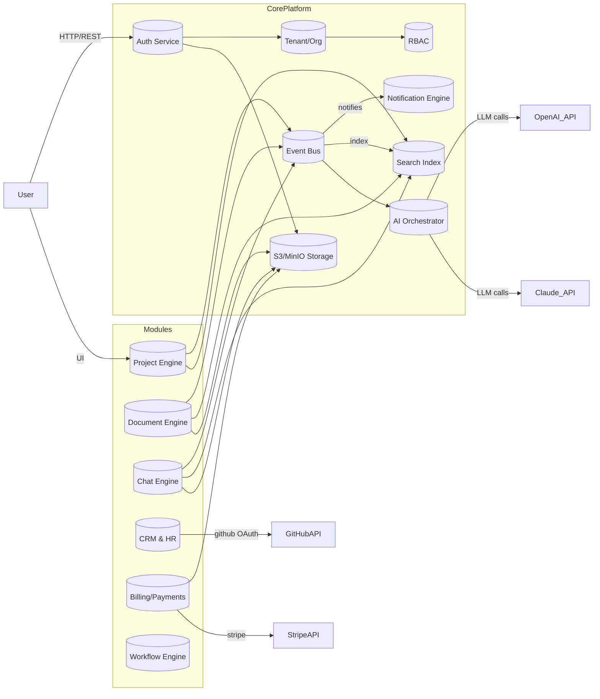
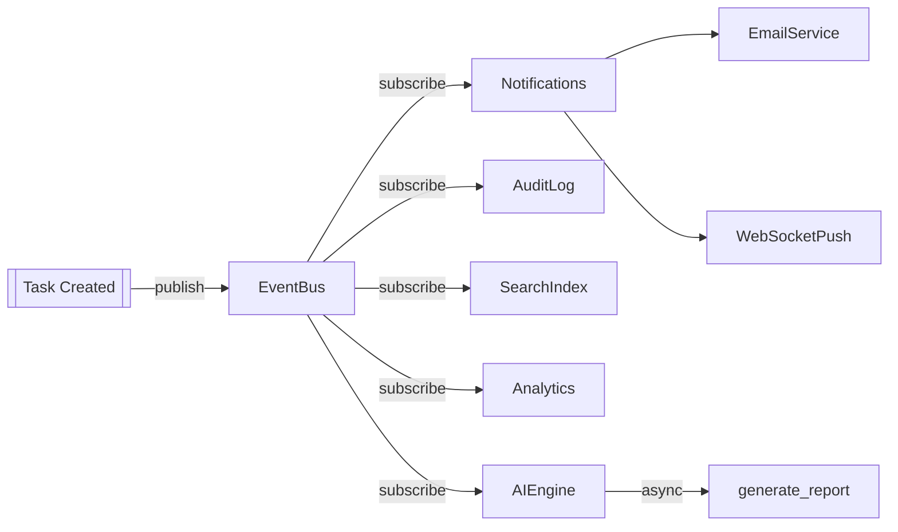
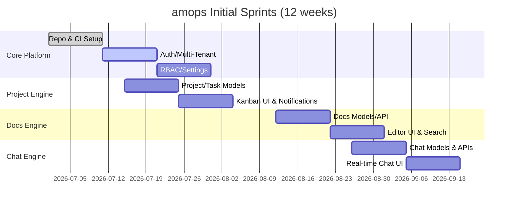

# Executive Summary  
**amops Developer OS** is a comprehensive **multi-tenant business platform** built with modern Django/Next.js technology. It provides *one unified system* for project management, collaboration, AI assistance, CRM/HR, and more – replacing siloed tools (Jira, Slack, Notion, GitHub, etc.). amops is architected as a **core platform engine** (tenant, auth, RBAC, notifications, events, search, AI, billing, etc.) plus ~20 reusable “**engines**” (Project, Docs, Chat, AI, CRM, HR, etc.), each production-ready and multi-tenant by design. We will build amops in *phases*, delivering a deployable MVP for each engine. Core tech choices (latest stable as of mid-2026) include **Django 5.2 LTS** with **Django REST Framework 3.16** on **PostgreSQL 16**; **Next.js 16.x** (React 19+) with **TypeScript** and **Tailwind CSS**; **Redis** for caching and channels; **Celery 5.x** for background tasks; **Django Channels** for WebSockets; **OpenSearch** (or Elasticsearch) for full-text search; **MinIO (S3)** for file storage; and containers (Docker/Kubernetes). We’ll integrate OAuth (Django Allauth), GitHub, Stripe, OpenAI/Claude APIs, etc. Security (HTTPS, rate limits, encryption, SSO), and monitoring (Prometheus/Grafana, Sentry) are built-in. Each feature will be scoped as Free/Pro/Enterprise tiers (e.g. free: small teams; pro: unlimited projects, AI/analytics; enterprise: SSO, audit logs). The following report details **all engines**, their components, data flows, deployments, an implementation roadmap (solo+team estimates), sprint plan, and tech comparisons.  

---

## Core Platform (Module 0)  
**Objective:** Provide the foundation for multi-tenancy, identity, permissions, notifications, search, storage, and events that all other modules use.  

- **Backend:** Django apps for `accounts` (CustomUser model, JWT/OAuth, user/profile), `orgs` (Tenant, Workspace, Teams, Roles, Permissions models), `core` (Settings, FeatureFlags). Use **PostgreSQL 16** with schemas or row-level tenant scoping. Key models: User (UUID PK), Tenant/Organization, Role/Permission (many-to-many), NotificationTemplate, AuditLog, etc. Celery tasks: send emails/push, generate reports, cleanup.  
- **Frontend:** Next.js (v16.x) pages/components for login, signup, tenant dashboard, user profile, settings, admin console. Use **React Query/TanStack Query** for data fetching, **Zustand** for global state (current user, theme). UX patterns: multi-tenant selector, role-based UI, forms (React Hook Form + Zod validation).  
- **Infra/Services:** Postgres for core data; **Redis** for caching and Channel layer; RabbitMQ (optional) or Redis as Celery broker; **MinIO/S3** for file uploads; **OpenSearch** for indexing all tenant data (users, resources, logs); configure Channels (ASGI) for events.  
- **Integrations:** OAuth (via django-allauth) for Google/Github SSO; Stripe for billing (Stripe Python SDK v15.x); SMS/Email gateways for notifications; LDAP/SAML (enterprise SSO); Keycloak (optional).  
- **Data flows/Events:** Publish/subscribe on an **event bus** (e.g. Kafka or RabbitMQ). Events: `user.created`, `org.created`, `role.assigned`, `feature.toggled`, etc. Each event triggers notifications, audit logs, search indexing, metrics.  
- **APIs:** Core REST endpoints (DRF) under `/api/v1/core/*` for auth (token), user, tenant, roles. WebSocket events for presence/notifications (e.g. via Channels groups). Webhooks: Stripe webhooks, GitHub webhooks. OpenAPI/Swagger with DRF Spectacular.  
- **Storage:** Files/avatars stored on S3 with signed URLs. Enforce per-tenant quotas and retention policies (e.g. limit total GB).  
- **Security:** JWT auth (djangorestframework-simplejwt) + refresh tokens; CSRF protection; RBAC enforced in views; multi-tenant isolation; encryption at rest (db S3); TLS everywhere. Rate-limit APIs (DRF throttling). CSP, CORS configs.  
- **Testing:** Unit tests for models, views; integration tests for multi-tenant scenarios (pytest-django); API contract tests; E2E tests via Cypress or Playwright for auth flows; load test core signup/login endpoints.  
- **Observability:** Emit metrics to Prometheus (via django-prometheus) for login/signup rate, DB connections; structured logs (JSON) to ELK or Grafana Loki; errors to Sentry; business metrics (user count, active tenants).  
- **Deployment:** Docker containers orchestrated with Kubernetes; use Gunicorn+Uvicorn; Nginx Ingress for TLS and LB; Horizontal Pod Autoscaler. CI/CD with GitHub Actions: lint, tests, build, deploy. Zero-downtime rolling updates.  
- **Cost/Ops:** Scale DB (read replicas), cache (Redis cluster), search (Elasticsearch cluster). Use on-demand CI runners. Monitor costly APIs (OpenAI usage).  
- **Monetization:** Tenant/org management is *free* baseline. **Pro**: advanced RBAC, feature flags, audit logs, activity feed. **Enterprise**: SSO (SAML/OIDC), custom roles, dedicated infrastructure, compliance (SOC2), premium support.  

**Tech Choices:** Django 5.2 LTS (batteries-included, mature ORM); DRF 3.16 (rich API toolkit); PostgreSQL 16 (robust RDBMS, advanced indexing); Redis (pub/sub, cache, channels); Celery 5.6 (latest stable, task queue); Channels (Django’s ASGI for websockets); OpenSearch 2.x (Apache-2.0 license, AWS support); Docker/K8s (containerization).  

---

## Module 1: Project Engine  
**Objective:** Full-featured project/task management (projects, epics, stories, tasks, sprints, kanban).  

- **Backend:** Django `projects` app: models Project, Milestone, Epic, Story, Task, Subtask, Label, Priority, Status, Dependency. Use DRF viewsets/serializers. Database schema: separate tables with FK to Tenant/Workspace; use GIN indexes on text fields. Celery tasks: scheduled sprint reminders, notification triggers (task due, dependency complete).  
- **Frontend:** Next.js pages/components: Project list, Kanban board, task detail, Gantt/roadmap. Use React DnD for drag-drop. State: React Query for project/task data; Zustand for temporary drag state. UX: pagination, lazy loading (infinite scroll or virtual list for boards), skeleton loaders for tasks.  
- **Infra/Services:** As above Core. Use Elasticsearch for project/task full-text search (title/description).  
- **Integrations:** GitHub links (commits/PR to tasks), Slack notifications on updates.  
- **Data flows:** Events: `task.created/updated/completed`, `story.estimated`, published to event bus. Subscribers: Notification service (email/websocket), Analytics (e.g. project velocity), Audit log, AI (e.g. generate report on completion).  
- **APIs:** CRUD REST endpoints (projects, tasks, etc.) with filtering (by status, due date) and ordering. WebSocket events: live updates on boards (e.g. a task moved triggers `task.moved` event to update other clients). Webhooks: integrate with CI/CD tools (e.g. bitbucket, GitHub PR).  
- **Storage:** Tasks/comments may have attachments (images, docs). Use S3/MinIO. Quota per workspace. Retain audit logs longer (enterprise) vs tasks data (archivable after project close).  
- **Security:** Only project members can access. Role permissions (e.g. PM, dev, viewer). Use row-level filters on Tenant. Audit each API call in log.  
- **Testing:** API tests for task flows (create, update, assign); unit tests for business rules (dependency checks, sprint capacity). E2E: simulate creating a project, sprint planning, closing tasks. Load-test boards with 1000 tasks.  
- **Observability:** Collect metrics: tasks per day, average completion time, boards active users. Logs for project changes.  
- **Deployment:** Scales like core; heavy users may require cached render (static fallback for Kanban).  
- **Monetization:** Free: basic projects and tasks (up to 5 users, 10 tasks). Pro: unlimited projects/sprints, advanced Kanban (custom columns, recurring tasks, dependencies), analytics. Enterprise: portfolio management (cross-project reporting), guarded statuses, enterprise timeline, SLA support.  

**Tech:** Django REST Framework (viewsets for CRUD); Django-filter (for filtering); React DnD (drag-drop boards); WebSockets via Channels for realtime updates. Elasticsearch/OpenSearch for fast search and filters. Use PostgreSQL with proper indexes and EXPLAIN-analysis for large data.  

---

## Module 2: Document Engine (Wiki/Docs)  
**Objective:** Rich content management (Notion-like) with versioning, markdown, AI-assisted summaries.  

- **Backend:** `docs` app: models Page, Section, Revision, Media (images/videos). Use a WYSIWYG/Markdown field (e.g. TipTap in React). Hierarchical/nested pages (self-referencing FK). History tracking (last N versions). Celery tasks: generate AI summary of page, OCR on images, scheduled backups.  
- **Frontend:** Pages for document lists, editor, view. Editor (rich text/markdown with code block support). Use react-markdown or Slate. State: React Query for fetching docs, optimistic updates when editing. UX: infinite scroll in page list, “collapsible sections”, mobile-responsive editor.  
- **Infra:** Elasticsearch for text search across docs; also use generative AI (OpenAI/Claude) for summarization.  
- **Integrations:** Google Docs/Figma embed, GitHub gists, Slack link previews.  
- **Data flows:** Event `doc.page.updated` triggers reindex, notifications (subscribers, watchers), AI summary job. Webhooks: allow external tools to push content (e.g. Git commits) into docs.  
- **APIs:** REST for CRUD pages, attachments. WebSocket: collaborative editing events (cursor positions).  
- **Storage:** Attachments (images, PDFs) on S3; auto-convert images to webp. Video preview thumbnails. Data retention: infinite page history for enterprise, default 30 days for free.  
- **Security:** Permission per page/team. Prevent XSS (sanitize HTML). Encryption for attachments at rest.  
- **Testing:** Content CRUD, search ranking; UI test: editing and saving a doc.  
- **Observability:** Monitor edit frequency, doc size distribution.  
- **Monetization:** Free: basic pages, wiki (versioning disabled). Pro: advanced editor, version history, templates, AI summary. Enterprise: document audit trail, comment history, compliance export (PDF/HTML).  

**Tech:** Use Django or third-party like [Wiki or Headless CMS] (but likely custom). Next.js dynamic import for editor (TipTap), Shadcn/ui for ready components. **TanStack Table** not directly needed (content heavy).  

---

## Module 3: Chat Engine (Real-time Chat)  
**Objective:** Team communication (channels, DMs, threads, live notifications).  

- **Backend:** `chat` app: models Channel, Message, Thread, Reaction, Presence. Use Redis/Channels for message pub/sub. Celery tasks: push notifications (email/push) for mentions, digest tasks.  
- **Frontend:** Chat UI like Slack. Pages/components: channel list, message view, input box, thread pane. Use **socket.io-client** or native WebSocket (via Channels) for real-time. State: Zustand for current channel/users; React Query not needed for live messages. UX: optimistic UI (sent messages), typing indicators, unread counts, virtualization for message lists. Use infinite scroll in message history.  
- **Infra:** Redis as Channel layer (pub/sub). PostgreSQL for storing messages. Optionally a NoSQL (Dynamo/Cassandra) for very high volume (depending on scale).  
- **Integrations:** Slack/Teams bridging (via webhooks), Figma/Google Drive previews, GitHub issue/chat bots.  
- **Data flows:** Messages published to channel group. Events: `message.sent/edited/deleted`, consumed by notification (push to mobiles), search indexing (full-text), analytics (active users), logging.  
- **APIs:** REST for channel management (create/join), fallback message fetch. WebSocket: send/receive messages, typing status, presence updates.  
- **Storage:** Message attachments on S3. Data retention policy (e.g. 90 days free, unlimited pro/enterprise). Option to auto-delete older messages.  
- **Security:** End-to-end encryption (future), enforce channel membership.  
- **Testing:** Load-test with 1000 concurrent users, message throughput. E2E chat flows.  
- **Observability:** Real-time user count, message rate, queue lengths.  
- **Monetization:** Free: basic chat (10 channels, 1000 msgs history). Pro: unlimited chat, file sharing, video notes. Enterprise: compliance (eDiscovery), DLP, retention controls, single-sign-on.  

**Tech:** Django Channels (ASGI) with Redis layer; Socket.IO or native (Next.js websockets); **Tailwind UI** for chat components.  

---

## Module 4: AI Engine (Assistants/Automation)  
**Objective:** Provide AI-powered assistance for generating content, reports, code, etc.  

- **Backend:** `ai` app: orchestrates calls to LLM APIs (OpenAI, Anthropic Claude, Google Gemini). Manage prompts and conversation context. Models: `AIModel` (config for GPT-5.5, Claude v4, etc.), `AIQuery`, `AIResponse`. Celery: batch async LLM calls, cost tracking, caching.  
- **Frontend:** UI for AI workflows: dashboards with prompts (e.g. “Generate sprint from project”). Components: chat interface for assistant, code review panel, report builder. Use React Query for async calls; show loading states.   
- **Infra:** External APIs (OpenAI 2.44.0, Anthropic Claude, Google Gemini/Vertex AI). Store API keys securely.  
- **Integrations:** Use AI to summarize meeting notes (meeting integration), analyze code (connect to GitHub repos). Tools: embed models as agents (JupyterLite for code execution?) if needed.  
- **Data flows:** User submits prompt → event `ai.task.requested` → queued task → call LLM API → result stored and pushed via `ai.task.completed`. Logging of tokens.  
- **APIs:** REST endpoints for each skill (e.g. `/api/v1/ai/generate_sprint`).  
- **Storage:** Store AI-generated content. Ensure GDPR compliance (scrub PII from prompts).  
- **Security:** Throttle usage by plan; protect secrets.  
- **Testing:** Mock LLM responses; test latency and fallback.  
- **Observability:** Monitor API usage, latency, error rates, cost. Alert if abnormal usage.  
- **Monetization:** **Pro**: basic AI tasks (summaries, reports). **Enterprise**: custom models, on-prem model hosting, priority access (less rate limiting), usage quotas. Charge per token or call beyond free tier.  

**Tech:** Use OpenAI Python SDK (v2.44.0); asynchronous HTTP with `asyncio`/httpx for faster throughput; Django async views. Possibly use LangChain or OpenAI function calls for structured outputs.  

---

## Module 5: Git & CI/CD Integration  
**Objective:** Connect code repositories and CI pipelines to amops projects.  

- **Backend:** `integrations` app: models for OAuth tokens (GitHub, GitLab), linked repositories, CI jobs, build logs. Celery tasks to poll/receive webhooks.  
- **Frontend:** Dashboard showing commits, PRs, pipelines. Components: project repo list, PR status, pipeline graph. Use GraphQL for GitHub (Apollo) or REST.  
- **Infra:** Webhooks from GitHub/GitLab; polling optional.  
- **Integrations:** OAuth apps for GitHub/GitLab; Jenkins/Travis via webhooks.  
- **Data flows:** `git.push` → webhook → update commit log in amops; `ci.pipeline.succeeded/failed` → update project board, send notifications.  
- **APIs:** `/api/v1/integrations/repos`, `/ci/status`.  
- **Security:** Store tokens encrypted. Only org owners authorize.  
- **Observability:** Monitor integration failures, sync lag.  
- **Monetization:** Free: read-only link to GitHub (commits, issues). Pro: write actions (create issues/tasks), CI status badges. Enterprise: private repo support, on-prem agent.  

**Tech:** GitHub’s REST/GraphQL API via [PyGitHub](https://pypi.org/project/PyGithub/); Jenkins API Python (if needed).  

---

## Module 6: CI/CD Dashboard  
**Objective:** Visualize build pipelines and deployments.  

- **Backend:** Extend `integrations`: models for Pipelines, Jobs, Logs. Parse CI webhook events (GitHub Actions, Jenkins).  
- **Frontend:** React charts (TanStack Chart) for pipeline durations, success rates; list of recent builds.  
- **Infra:** Ingest logs (ELK or Loki).  
- **APIs:** Expose pipeline status and metrics.  
- **Security:** OAuth with CI tools; restrict to project members.  
- **Monetization:** Part of Pro/Enterprise; advanced metrics only for paid.  

**Tech:** Use Octokit for GitHub Actions API; restful JSON logs.  

---

## Module 7: Monitoring & Metrics  
**Objective:** Real-time system and project health dashboards.  

- **Backend:** `monitoring` app: integrate with Prometheus (export project metrics), or use agent.  
- **Frontend:** Grafana embedded, or custom Next.js dashboards (Recharts or Grafana UI).  
- **Infra:** Prometheus node exporter, cAdvisor, alertmanager. Elasticsearch/Kibana for logs.  
- **Metrics:** CPU/RAM (server metrics), app-specific (API latency, queue lengths, error rates).  
- **Monetization:** Included for SaaS ops; project-level analytics Pro/Enterprise (burndown charts, velocity).  

**Tech:** Prometheus, Grafana (cite [28†L1-L8]); Django Prometheus exporter.  

---

## Module 8: Time Tracking & HR  
**Objective:** Track work hours, timesheets, leave, payroll export.  

- **Backend:** `time` and `hr` apps: models Employee, TimesheetEntry, Holiday, LeaveRequest, Attendance, Asset.  
- **Frontend:** Timer UI (Start/Stop), calendar view, timesheet form. HR: org chart, request forms. Use Tailwind forms and modal dialogs.  
- **Data flows:** On clock-out → event logs entry, triggers manager approval workflow.  
- **Security:** GDPR for employee data, SSO, admin-only payroll.  
- **Monetization:** Pro: timesheets, reports; Enterprise: payroll integration, asset management.  

**Tech:** Time tracking often uses standard models. Maybe integrate with third-party (e.g. Toggl API) as alternative (explain in table).  

---

## Module 9: CRM & Sales  
**Objective:** Manage leads, contacts, deals, invoices, payments.  

- **Backend:** `crm` app: models Lead, Contact, Company, Deal, Stage, Activity. Integration with Email (send mails).  
- **Frontend:** Kanban pipeline for deals, customer list, contact form. Use React Table for lists.  
- **Integrations:** Email (SMTP), payments (Stripe API for subscriptions/invoicing).  
- **Data flows:** `deal.won` triggers Invoice creation, `invoice.paid` triggers `crm.deal.closed`.  
- **Monetization:** CRM module itself could be a paid addon (free: up to 100 leads, pro: unlimited, enterprise: custom objects).  

**Tech:** Stripe Billing (Stripe Python v15.x for subscriptions/invoices); Django ORM.  

---

## Module 10: Client Portal  
**Objective:** External-facing mini-app for clients.  

- **Backend:** `client_portal` app: exposes selective project/task data to client users. Models: ClientUser, Access rights.  
- **Frontend:** Secured Next.js site under unique subdomain. Pages: project overview, upload interface (dropzone), invoice download. Reuse components from core (header, menu).  
- **Security:** Strict RBAC; separate JWT/session for clients.  
- **Monetization:** Core part of SaaS offering.  

**Tech:** Next.js custom server for multi-domain, role-based UI rendering.  

---

## Module 11: Knowledge Base  
**Objective:** Publish FAQs, SOPs, API docs, training content.  

- **Backend:** Could reuse `docs` engine with different templates/taxonomy.  
- **Frontend:** Public-facing site section. Use Markdown for docs, search.  
- **Monetization:** Normally free for basic; enterprise gets private KB.  

**Tech:** Possibly leverage Next.js static export for KB.  

---

## Module 12: Notifications Center  
**Objective:** Centralize all notifications channels.  

- **Backend:** `notifications` app: In-app notifications (model), email sender, push notifications (WebPush, mobile), SMS (via Twilio). Models: Notification, ChannelSetting.  
- **Frontend:** Bell icon dropdown; notification list page. Preferences page to opt in.  
- **Data flows:** All modules push notifications here: subscribe to events (`task.assigned`, `message.mention`, `ai.report.ready`), queue for user.  
- **Monetization:** Premium: priority channels (SMS, custom templates), unlimited in-app.  

**Tech:** django-channels for real-time badges; Celery + django-template for email.  

---

## Module 13: File Manager  
**Objective:** Google-Drive-like file repository per workspace.  

- **Backend:** `files` app: models Folder, FileVersion, Permission. Use S3/MinIO with signed URLs.  
- **Frontend:** React tree view or grid, drag&drop upload, preview (images/videos). Use virtualization for large folders.  
- **Storage:** S3 lifecycle policies; versioning. Quotas per plan.  
- **Monetization:** Pro: unlimited storage, virus scan; Enterprise: DLP, encryption keys.  

**Tech:** Use AWS SDK for Python (boto3) with presigned URL generation.  

---

## Module 14: Analytics & Reports  
**Objective:** Cross-module metrics (project velocity, burndown, revenue, custom dashboards).  

- **Backend:** Aggregation using TimeScaleDB or ClickHouse for time-series? Could use Postgres + Pandas. Models: MetricDefinition, Dashboard.  
- **Frontend:** Charting (Recharts or Chart.js), drag-drop widget dashboards. Filterable reports (CSV/PDF export).  
- **Data flows:** Projects, CRM, HR modules emit events/metrics. Use Celery to aggregate daily/weekly.  
- **Monetization:** Pro: canned reports (burndown, velocity charts); Enterprise: custom report builder, raw data export.  

**Tech:** Use Pandas or Superset for ad-hoc queries; embed via iframe or API.  

---

## Module 15: Billing & Subscription  
**Objective:** Manage plans, billing, usage, and payments.  

- **Backend:** `billing` app: models Plan, Subscription, Invoice (or use Stripe). Stripe webhooks to update DB.  
- **Frontend:** Admin UI for plan management; user UI for upgrade/downgrade, coupon entry.  
- **Integrations:** Stripe API (checkout, billing portal).  
- **Data flows:** On payment success → user subscription active; on cancellation → send warnings, revoke pro access.  
- **Security:** PCI compliance (Stripe handles it).  
- **Monetization:** Core (duh).  

**Tech:** Stripe Python library (v15.x) + Django signals for webhook handling.  

---

## Module 16: Automation/Workflow Engine  
**Objective:** User-defined workflows (if-this-then-that triggers across modules).  

- **Backend:** `automation` app: models Trigger, Condition, Action. Use JSON rules stored in DB; Celery to evaluate.  
- **Frontend:** Builder UI (flowchart or simple rule editor). Use a library like Blockly or custom React forms.  
- **Examples:** “When task closed and high priority → send email to PM, add to report, advance sprint”.  
- **Data flows:** On event, check triggers; if match, queue actions (e.g. `send_email`, `create_issue`).  
- **Monetization:** Enterprise feature (complex automations).  

**Tech:** Possibly integrate n8n (open-source) or build minimal.  

---

## Module 17: Marketplace/Plugins  
**Objective:** Extend amops via third-party apps.  

- **Backend:** `marketplace` app: list of available integrations (Calendar, Zoom, AWS, Figma, Discord, etc.). OAuth/client credentials stored.  
- **Frontend:** Plugin store page; toggle to install/uninstall.  
- **Data flows:** Plugins can register webhooks or subscribe to events.  
- **Monetization:** Partners can list paid plugins; amops takes cut. Enterprise self-host can allow custom plugins.  

**Tech:** Use OAuth (for Zoom, AWS, etc.), or Zapier-like connectors.  

---

## Prioritization and Phases  
We break into **phases**, each delivering an MVP engine (with minimal safe scope):

- **Phase 0 (Core Platform):** Tenant, Auth, RBAC, Notifications, Search, Event Bus, CI/CD, DB schema. *(Solo: 6-8 weeks; Team 3w)*  
- **Phase 1 (Project Engine):** Projects, Tasks, Sprints, Kanban UI. *(Solo: 6-8w; Team 3w)*  
- **Phase 2 (Docs Engine):** Wiki pages, editor, versioning. *(Solo: 4-6w; Team 2w)*  
- **Phase 3 (Chat Engine):** Real-time channels, DMs. *(Solo: 4-6w; Team 2w)*  
- **Phase 4 (AI Engine):** AI assistant integration (OpenAI/Claude). *(Solo: 4-6w; Team 2w)*  
- **Phase 5 (CRM/HR/Time):** CRM or HR (combine in 2 weeks for team, 4+ solo).  
- **Phase 6 (Other Modules):** Calendar, KB, Analytics, etc in subsequent phases.  

These are **minimal MVP** estimates with an AI-augmented workflow. A 3-dev team would roughly halve the solo times. Modules listed above under Phase 1-6 are not all; some (like Billing) come later near launch.

---

## Milestones & Sprints (First 6 Sprints)  

| Sprint | Duration | Deliverables                                            | Acceptance Criteria                                        | CI/CD Gates                                            |
|--------|----------|---------------------------------------------------------|-----------------------------------------------------------|-------------------------------------------------------|
| 1      | 2w       | Repo setup (monorepo); Docker/K8s CI; Core Auth schemas; user login/logout; basic tenant creation. | CI passing: `docker-compose up` works; signup/login test OK; multi-tenant DB switching validated. | Lint, unit tests (py, ts), basic e2e login test. |
| 2      | 2w       | Core RBAC (roles/permissions); tenant/workspace CRUD; settings UI; email service (Celery). | Role-based API tested; feature flag toggling; email signup confirmation working. | Integration tests for RBAC; 100% build. |
| 3      | 2w       | Project Engine MVP: project/task models; list/create API; Next.js project list/page; task CRUD. | Project endpoints in API (CRUD); Next UI shows projects; cross-tenant isolation test. | End-to-end test: create project via API, see in UI. |
| 4      | 2w       | Project Engine UIs: Kanban board, drag/drop, filters; notifications on task assignment. | Kanban drag updates DB; real-time (WS) update of board; notification email on task assign. | Performance test: 1000 tasks load; code review. |
| 5      | 2w       | Docs Engine MVP: page creation/editing; markdown view; search indexing. | Create/edit a doc in UI; search returns it; version history recorded. | Security scan (XSS), acceptance of doc editor. |
| 6      | 2w       | Chat Engine MVP: one channel, message send/receive (real-time); user presence indicator. | Two users can send/receive messages live; online count shown; UI tests. | Load test 100 concurrent, monitor message latency. |

**CI/CD gates**: Each sprint’s end must pass unit tests, integration tests (database rollback), code linting, and security scans. Code reviews require test coverage ≥ 80%. E2E pipelines (e.g. Playwright) cover critical user flows. Each feature only merges to main if all tests and a demo deployment on staging succeed.

---

## Tech Comparison Tables

**Search Engine Options (2026):**  

| Feature            | Elasticsearch 8.x                 | OpenSearch 2.x                   | MeiliSearch 1.x                | Typesense 1.x                 |
|--------------------|-----------------------------------|----------------------------------|-------------------------------|------------------------------|
| License            | Apache 2.0 (<=2021) / AGPLv3 (2024+) | Apache 2.0        | MIT (open-source)             | AGPL (open-source)           |
| Scalability        | Horizontally scalable; rich sharding | Horizontally scalable; AWS-optimized | Single-node by default; less mature clustering | Single-node; supports multi node (Alpha) |
| Features           | Mature analytics, ML, vectors, Kibana | Similar core features; OpenSearch Dashboards | Focused search (easy setup, typo tolerance) | Simpler search API (fast startup) |
| Ecosystem          | Large, enterprise plugins (X-Pack) | Growing, AWS support, community | Small, less ecosystem         | Small, community-driven      |
| Rationale          | Use if advanced features/Kibana needed | Use for fully open-source, AWS-managed (no license fees) | Use if you need lightning setup & have simpler needs | Use if you prefer simpler codebase (fewer features) |

**Message Broker Options:**  

| Feature            | RabbitMQ (v3.10+)                       | Redis Streams (v7.x)                | Apache Kafka (v3.x)            | AWS SQS                        |
|--------------------|-----------------------------------------|-------------------------------------|--------------------------------|--------------------------------|
| Model              | AMQP broker, push to consumers   | Log-based queues, simple pub/sub    | Distributed log (topics/partitions)   | Managed queue (no actors)      |
| Throughput         | Thousands/sec (scale with clusters) | High (in-memory, limited disk)      | Millions/sec (sequential I/O) | Tens of thousands, reliable   |
| Durability         | Ack-based delete on consume        | Retention configurable; not durable like Kafka | Durable logs with retention       | Fully durable, 99.9% uptime |
| Complexity         | Moderate; needs broker setup           | Simple (if you already use Redis)    | Complex (Zookeeper/KRaft)     | Low (serverless)               |
| Rationale          | Good for Celery, complex routing; easy monitoring. | Use if already on Redis and simpler needs. | Use for high-throughput event bus (big data). | Use to offload management (no self-host). |

**Real-Time Frontend:**  

| Option      | Pros                                   | Cons                             | Use-case                              |
|-------------|----------------------------------------|----------------------------------|---------------------------------------|
| WebSockets  | Full-duplex, instant, binary support | Needs persistent connection, overhead | Chat, live updates (we use via Channels) |
| SSE         | Simpler (HTTP stream); good for one-way | No binary, no two-way; limited older browser support | Notifications, one-way feeds        |
| Polling     | Easy, works everywhere                | High latency, load on server    | Fallback only                           |
| **Chosen:** WebSockets via Django Channels for chat and live updates.  

**Frontend Frameworks (React Meta-framework):**  

| Feature        | Next.js 16.x (React)            | Remix 3 (React)             | SvelteKit 2.x (Svelte)        |
|----------------|---------------------------------|-----------------------------|------------------------------|
| Rendering      | SSR/SSG + client (app dir)* | SSR only (modern React)      | SSR + client, very lean        |
| Data Fetching  | React Query etc., incremental Static site | Built-in loaders/actions      | Stores, JS in Svelte files    |
| Ecosystem      | Very large (Vercel support)    | Mature React router-based   | Smaller, very fast reactive   |
| Learning Curve | Moderate (JSX, TS, React)      | Moderate (convention-based) | Steep (new syntax)            |
| Use-case       | General-purpose (we pick this) | Good for form-heavy apps     | Good for SPAs, but community smaller |
| Rationale      | Next.js LTS (16.x) is proven and widely used; strong SSR/SSG and React support.  

(*Next.js app-dir with React Server Components*)  

---

## Risks & Mitigations  
- **Scope creep:** We mitigate by strict per-module MVP scope; any extras go to backlog.  
- **Multi-tenancy bugs:** Rigorous testing of tenant isolation (pytest-django with multiple schemas).  
- **Performance at scale:** Early benchmarking (Postgres, Redis cluster), use of INDEX/EXPLAIN for slow queries.  
- **Security:** Regular audits (Dependabot, Snyk) and pen-testing, strict CSP/CORS.  
- **AI API costs:** Set usage alerts, cache/limit queries, consider on-prem LLM for enterprise.  

---

## Milestones (6 Sprints, 2w each)  

1. **Sprint 1 (Week 1–2):**  
   - Setup monorepo (backend/ frontend / infra).  
   - CI pipeline (lint, tests) and staging environment (Docker).  
   - Implement Core Auth (User, Org models; JWT auth).  
   - **Criterias:** Users can sign up/log in; JWT-secured endpoints. CI green; bare admin page loads.  

2. **Sprint 2 (Week 3–4):**  
   - Core: RBAC (Role, Permission) models; tenant/workspace CRUD.  
   - Basic settings UI (theme, language).  
   - Email (Celery) for verification.  
   - **Criterias:** Users in same Org see roles; settings saved; welcome email sent. Tests for RBAC pass.  

3. **Sprint 3 (Week 5–6):**  
   - Project Engine MVP: Project/Task models & APIs.  
   - Next.js UI: Project list and task CRUD forms.  
   - Multi-tenant enforcement.  
   - **Criterias:** Create project via API, view in UI; tasks persisted correctly. No cross-tenant bleed.  

4. **Sprint 4 (Week 7–8):**  
   - Kanban UI: Drag/drop tasks, custom statuses.  
   - Notifications: email/in-app on task assignment.  
   - Search integration: index projects/tasks.  
   - **Criterias:** Moving a task updates DB; assigned user gets email. Search returns tasks by keyword. Load test: 1000 tasks.  

5. **Sprint 5 (Week 9–10):**  
   - Docs Engine MVP: Create/edit pages, markdown render.  
   - Version history (simple).  
   - **Criterias:** Edit/restore page versions; full-text search on docs works.  

6. **Sprint 6 (Week 11–12):**  
   - Chat Engine MVP: Create channels, send messages (WS).  
   - Presence indicator.  
   - **Criterias:** Two users see each other's messages real-time; offline messages fetched.  

*After Sprint 6, we have a fully demoable platform with core + 3 main engines. Next sprints continue similarly.*  

---

## Deployment & Ops  

- **Containerization:** All services in Docker; use multi-stage builds; Helm charts for K8s.  
- **Load Balancing:** Kubernetes Ingress (Nginx or Traefik) with autoscaling. Use managed Postgres (Cloud SQL/Azure DB) and managed Redis (ElastiCache/Redis Cloud).  
- **CI/CD:** GitHub Actions with jobs: lint → test → build images → push → deploy to staging/production. Canary releases.  
- **Scaling:** HPA on web/Celery pods; read-replicas for Postgres; sharded Redis cluster; OpenSearch cluster with replicas.  
- **Monitoring/Alerts:** Prometheus + Grafana for infra/app metrics; alerts for CPU >80%, latency, error rate; Sentry for exceptions.  

---

## Metric & Testing Strategy  

- **Unit Tests:** PyTest for Django models, utils; Jest/RTL for Next.js components.  
- **Integration Tests:** DB transaction tests; REST API tests; Celery worker tests; use testcontainers for Postgres in CI.  
- **E2E Tests:** Cypress or Playwright to simulate user flows (signup, create project, chat).  
- **Load Tests:** Locust or k6 to simulate concurrent users on core flows (task creation, websocket chat).  
- **Performance Monitoring:** Use New Relic or open telemetry for end-to-end traces. Collect RPS, latencies for each endpoint.  

---

## Monetization Hooks  

Every module above is designed with **tiers**:  
- **Free:** Core auth, limited projects, basic chat, basic docs.  
- **Pro:** Unlimited usage, advanced features (see module notes), AI credits, custom branding.  
- **Enterprise:** SSO, audit logs, compliance, dedicated support, on-premise deploy, custom modules.  

We’ll hard-code feature flags and plan checks in code (e.g. block access to enterprise features). Billing module integrates with Stripe to gate based on subscription status.  

---

## Alternative Tech Considerations  

We considered but did not pick:  
- **Flask/FastAPI vs Django:** Chose Django for its ecosystem and batteries-included approach.  
- **PostgreSQL vs MySQL vs NoSQL:** Chose Postgres for strong relational/JSON support, indexing.  
- **OpenSearch vs Elasticsearch:** Chose OpenSearch for Apache license; Elasticsearch if enterprise features needed.  
- **RabbitMQ vs Kafka:** RabbitMQ for Celery (simple routing); Kafka if future event streaming required.  
- **Next.js vs Others:** Next.js for maturity; alternatives (Remix, Svelte) have smaller ecosystem.  
- **Redis vs Memcached for cache:** Redis used for channels and as key-value cache (familiar in Django).  
- **MinIO vs AWS S3:** MinIO for dev/local (S3-compatible) and S3 for prod (cost-effective, CDN).  

*(Comparison tables above summarize key trade-offs.)*  

---

## Architecture (Mermaid)  

Here is a high-level architecture diagram of amops (Core Platform + Modules) and data flows:  

*(Nodes in CorePlatform provide shared services; arrows indicate data/API flows.)*  

---

## Task Lifecycle Event Flow (Mermaid)  

When a task is created or updated in Projects:  

This shows `TaskCreated` event triggering multiple subscribers: send user notifications (email/websocket), log for audit, index in search, update analytics counters, and optionally kick off an AI workflow (e.g. “generate standup update”).  

---

## Timeline Gantt (Mermaid)  

First 6 sprints (12 weeks) overview:  

*(Dates are illustrative; “done/active” show progress.)*  

---

**Sources:** We base choices on official documentation and recent analyses. For example, we adopt **Django 5.2 LTS** and **DRF 3.16** (ensures long-term support), **PostgreSQL 16**, **Next.js 16.x**, and industry standards like **Redis**, **Celery 5.x**, **Django Channels** and **Prometheus/Grafana** for observability. We reference the open-source vs license tradeoff of **OpenSearch (Apache 2.0)** vs **Elasticsearch (AGPLv3)**, and messaging brokers (**Kafka vs RabbitMQ performance**). This plan blends up-to-date best practices with a clear roadmap, making amops a robust, maintainable platform ready for real-world use and monetization.  

